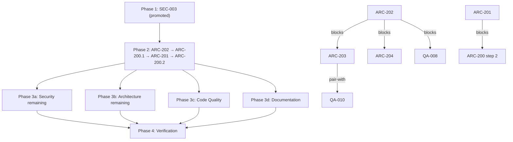

# Project Audit Report

> **Project**: parsidion (`~/Repos/parsidion`)
> **Date**: 2026-11-13
> **Stack**: Python 3.13+ (stdlib-only hooks/scripts layer), setuptools/uv packaging, Next.js/TypeScript visualizer (bun), parsidion-mcp (FastMCP), POSIX shell hooks
> **Audited by**: Claude Code Audit System (Fable 5 subagents, `/fable-audit`)
> **Audit basis**: parsight index current at HEAD `7cd3b6c`; working tree clean. All four domains ran deep-model agents on effort high.

---

## Executive Summary

The architecture is deliberate and unusually well gate-enforced — decision-recorded (ARC-001…105), zero runtime dependencies, executable stdlib-only enforcement, generated-contract drift gates, and a strong layered visualizer auth model. No critical findings in any domain. The standing debt is concentrated in structure, not rot: the ARC-001 flat-shim migration stalled halfway (75 files still import the shim surface `parsidion-mcp` keeps alive), the wheel ships un-namespaced top-level `core`/`cli` packages that can silently collide with sibling dependencies, and shared write-path logic (backups, frontmatter, recall injection, TUI scaffolds) exists in two-to-four private copies per pipeline. Estimated effort to remediate all high issues: large but mechanical — the gates make each phase independently verifiable. One positive strength worth naming: this repo treats its own conventions as executable contracts, which is exactly what makes the remediation plan below safe to run in phases.

### Issue Count by Severity

| Severity | Architecture | Security | Code Quality | Documentation | Total |
|----------|:-----------:|:--------:|:------------:|:-------------:|:-----:|
| 🔴 Critical | 0 | 0 | 0 | 0 | **0** |
| 🟠 High     | 5 | 0 | 1 | 0 | **6** |
| 🟡 Medium   | 5 | 1 | 3 | 1 | **10** |
| 🔵 Low      | 2 | 2 | 3 | 2 | **9** |
| **Total**   | **12** | **3** | **7** | **3** | **25** |

Dedup note: the four agents' findings were merged where they described the same defect. Merged into **ARC-202** (duplicated write-path logic): QA-001 (recall/injection pipeline duplicated across the two retrieval hooks), QA-005 (triplicated TUI/backup/rebuild helpers), QA-006 (byte-identical antigravity payload helper), QA-012 (frontmatter assembly ×4), QA-013 (vault_path intra-file duplication). Merged into **ARC-203**: QA-003 (god files). Merged into **ARC-204**: QA-004 (complexity band 23–29). Merged into **ARC-210**: QA-007 (visualizer component god-files/duplication). Two unlabeled quality suggestions were minted as QA-015 (installer hooks merge-logic test gap) and QA-016 (ruff B904 disabled).

---

## 🔴 Critical Issues (Resolve Immediately)

None.

---

## 🟠 High Priority Issues

### [ARC-200] Half-migrated dual import surface: flat shims + `core/` subpackage coexist
- **Area**: Architecture
- **Location**: `skills/parsidion/scripts/vault_common.py` (deprecation policy), `pyproject.toml:151-174` (18 shim `F401` exemptions), 49 flat modules at `scripts/` root; `parsidion-mcp/src/parsidion_mcp/` imports the flat names
- **Description**: ARC-001/ARC-005 split implementations into `core/` but kept ~25 flat re-export shims "for external callers." 75 files still import the shim surface vs 72 importing `core.` directly. `parsidion-mcp` — the named external consumer — imports flat names, so the shims cannot be deleted. The dual surface creates the documented monkeypatch footgun (patch `core.ai_backend` directly vs a carrier's attribute reach different objects) and permanently carries 18 lint exemptions.
- **Impact**: every core-module refactor maintains two import paths and two patch targets; new contributors must learn which name is canonical.
- **Remedy**: migrate `parsidion-mcp` imports to `core.*` (step 1, see ARC-201 ordering), delete the flat shims in one major release with a raising deprecation shim, and give ARC-001 Phase 2 a target release number.

### [ARC-201] Wheel installs maximally generic top-level names into site-packages
- **Area**: Architecture
- **Location**: `pyproject.toml:57-119` (`py-modules` + `packages.find where=skills/parsidion/scripts`)
- **Description**: the wheel ships top-level packages literally named `core`, `cli`, `doctor`, `summarizer`, `session_start` plus 49 flat modules with generic names (`subproc_util`, `transcript_reader`, `ai_backend`, …). No `parsidion` namespace exists. Nothing protects against a sibling dependency shipping a top-level `core` — last-installed wins silently.
- **Impact**: latent import-collision breakage (parsidion-mcp's venv pulls fastmcp + OpenTelemetry; any future dep with top-level `core`/`cli` breaks the MCP server at import). Blocks any future PyPI publication under these names.
- **Remedy**: re-namespace to `parsidion.*` with thin legacy shims; existing manifest + stdlib gates make it mechanical and test-verified.

### [ARC-202] Shared write-path logic exists as private copies across pipelines (merged QA-001/005/006/012/013)
- **Area**: Architecture + Code Quality
- **Location**:
  - `_excerpt`/`_build_context`: `user_prompt_submit_hook.py:258-321` vs `pre_tool_use_hook.py:325-390` (similarity 0.993 / 0.947) — QA-001
  - `_backup_note`: `core/vault_fs.py:351`, `summarizer/notes.py:438`, `doctor/_state.py:264` (0.935) — QA-005
  - `rebuild_index`: `installer/skill.py:513`, `parsidion-mcp/src/parsidion_mcp/tools/ops.py:37`, `summarizer/queue.py:240` — QA-005
  - `_run_tui`: `vault_conflicts.py:400`, `vault_review.py:520`, `vault_tui.py:253` (~109 lines each) — QA-005
  - `_to_shared_payload`: byte-identical in `antigravity_session_start_hook.py:36` and `antigravity_session_end_hook.py:39` — QA-006
  - `_build_frontmatter`: `vault_merge.py:302`, `vault_new.py:55`, plus `tools/migrate_*.py` one-offs — QA-012
  - `is_path_inside_vault` vs `is_symlink_inside_vault`: `core/vault_path.py:497/477` (0.90) — QA-013
- **Description**: the summarizer, doctor, merge/CLI, and hook layers each reimplement backup-on-write, frontmatter construction, index rebuilds, and the recall-injection excerpt/context builders instead of routing through `core`. The antigravity copies are exactly the pattern the ARC-020 adapter registry was built to eliminate.
- **Impact**: a semantic fix (e.g. the atomic-write class pinned in `tests/test_atomic_write_fixes.py`) must be found and applied in 2–4 places; pipelines drift silently on the project's most behavior-critical surfaces.
- **Remedy**: hoist `backup_note` and frontmatter construction into `core` (stdlib-safe); share the TUI scaffold in `vault_tui.py`; fold antigravity payload helpers into `agent_adapter`; extract a shared `recall_context.py` for the two retrieval hooks; route all rebuilds through one function.

### [ARC-203] God files in the core scripts layer; grab-bag modules with extreme fan-in (merged QA-003)
- **Area**: Architecture + Code Quality
- **Location**: `core/vault_index.py` (1,711 lines, 42 fns, complexity 237, fan-in 53; `parse_frontmatter` fan-in 54), `agent_adapter.py` (1,348, fan-in 102), `core/vault_fs.py` (1,333, fan-in 44), `core/parsight_backend.py` (1,078), `core/ai_backend.py` (1,063), `core/vault_path.py` (997, fan-in 62), `installer/hooks.py` (1,063), `build_graph.py` (1,066)
- **Description**: `vault_index.py` alone is the frontmatter parser, the note-index schema/SQL layer, and the prompt-context builder. Eight files at/near 1,000+ lines carry aggregate complexity 125–237.
- **Impact**: highest fan-in files concentrate refactor risk; unrelated changes share a blast radius.
- **Remedy**: split `vault_index` into frontmatter-parsing / note_index-SQL / context-builder modules (update `tests/test_stdlib_only.py::_ENFORCEMENT_SCOPE` in the same change — see QA-010); split `agent_adapter` pipeline bodies from adapter descriptors. Lower-fan-in files (`build_graph.py`, `installer/hooks.py`) are safer first moves.

### [ARC-204] Complexity hotspots concentrated in entry-point functions (merged QA-004)
- **Area**: Architecture + Code Quality
- **Location**: `user_prompt_submit_hook.py:324` `run_recall` (29), `html-to-md.py:153` (28), `vault_merge.py:460` `main` (28), `visualizer/components/ReadingPane.tsx:29` (28), `installer/skill.py:56` `install_skill` (27), `installer/cli.py:599` `main` (27), `core/parsight_backend.py:734` `parsight_search` (27), `pre_compact_hook.py:107` `extract_file_paths` (26), `summarize_sessions.py:893` `main` (23) — 15 functions in the 23–29 band
- **Description**: pipeline functions that inline every stage; nested >4 levels in `_html_to_markdown` and `extract_file_paths`.
- **Impact**: every change lands in these; they dominate review cost and regression risk. Test-only protection today.
- **Remedy**: extract per-stage helpers for the worst three (`run_recall` stages, `_html_to_markdown` per-node handlers, `extract_file_paths` line-type parsers); table-driven dispatch in CLI mains. Preserve the documented never-raises/fail-open hook contracts pinned by the hook test suites.

### [QA-002] Metadata query re-implemented outside the core module
- **Area**: Code Quality
- **Location**: `skills/parsidion/scripts/cli/search/metadata.py:32-155` vs `core/vault_index.py:651-727` (`query_note_index`)
- **Description**: the CLI's `query()` is a 124-line near-duplicate (0.906) of `query_note_index()` — same table probe, WHERE construction, migration handling.
- **Impact**: two SQL paths for the same table can diverge; `vault-search -T/-f/...` and MCP/core callers could return different results.
- **Remedy**: make `cli/search/metadata.py:query()` delegate to `query_note_index()`. Independent, low-risk.

---

## 🟡 Medium Priority Issues

### [SEC-001] Untrusted-data framing missing in the hierarchical chunk-summarization prompt
- **Area**: Security (CWE-1427 / OWASP A03, LLM prompt injection)
- **Location**: `skills/parsidion/templates/prompts/summarize-chunk.md` (whole template); caller `summarizer/transcript.py:234`; template mapping `summarizer/prompt.py:110`
- **Description**: sibling templates (`summarize-session.md`, `merge-notes.md`, `select-notes.md`, `detect-conflicts.md`) wrap inlined transcripts in explicit UNTRUSTED DATA framing. `summarize-chunk.md` inlines `$chunk_text` raw. The chunk path handles oversized transcripts — the sessions most likely to carry adversarial content — and its output feeds the final note-synthesis pass.
- **Impact**: injected instructions in a transcript can steer the chunk summary; the steered content propagates into an AI-generated vault note injected into future sessions.
- **Remedy**: add the same SYSTEM untrusted-data preamble used in `summarize-session.md`, wrap `$chunk_text` in delimiters, pin with a template-content test. Verified by the orchestrator (template read; no framing present).

### [QA-008] Stringly-typed config access with scattered conversions
- **Area**: Code Quality
- **Location**: `user_prompt_submit_hook.py:216-456` (13 `# type: ignore[arg-type]` + `int()`/`float()` at every use), `pre_tool_use_hook.py` (same), `prompt_templates.py:247`
- **Description**: config values arrive as untyped scalars from the hand-rolled YAML parser; every consumer re-converts and suppresses pyright.
- **Impact**: a malformed config value raises inside a swallowing stage, silently degrading recall; the ignores hide real type errors in a security-relevant hook.
- **Remedy**: read these sections through `load_typed_config()` (`core/vault_schema.py` already carries typed fields with real defaults).

### [QA-009] Broad exception swallowing in non-hook CLIs without debug logging
- **Area**: Code Quality
- **Location**: 54 `except Exception:` sites across `scripts/`; heaviest `core/parsight_backend.py` (12), `pre_tool_use_hook.py` (11), `user_prompt_submit_hook.py` (10), `agent_adapter.py` (8), `core/vault_health.py` (6), `cli/search/embeddings.py` (5)
- **Description**: the hook-layer fail-open pattern is deliberate and annotated, but inner stages log nothing — only cumulative stage timings reach `hook_events.log`. CLI tools borrow broad catches where a logged warning fits.
- **Impact**: stage-level failures invisible; debugging relies on inference from absent output.
- **Remedy**: keep fail-open behavior; add debug-gated log lines (a `debug` config key already exists in both hooks) inside swallow sites.

### [QA-010] Stdlib-only gate does not cover three subpackages
- **Area**: Code Quality
- **Location**: `tests/test_stdlib_only.py` `_ENFORCEMENT_SCOPE`
- **Description**: `summarizer/`, `doctor/`, and `cli/` subpackages are outside the executable stdlib-only gate (per the repo's own CLAUDE.md); clean only by convention.
- **Impact**: a future third-party import there fails no gate, eroding the ARC-004 guarantee.
- **Remedy**: extend `_ENFORCEMENT_SCOPE` to enumerate the three subpackages' modules. Combine with the ARC-203 vault_index split to avoid two touches of the same test file.

### [ARC-205] Installer duplicates core vault-discovery logic without a parity gate
- **Area**: Architecture
- **Location**: `installer/vault.py:673` `_default_vault_path` vs `core/vault_path.py:67` `default_vault_root` (similarity 0.912)
- **Description**: the installer reimplements default vault-path resolution instead of importing it (both sides obey stdlib-only, so the copy is legal but ungated).
- **Impact**: a change to default discovery (legacy `ClaudeVault` fallback) can ship in `core` and miss the installer.
- **Remedy**: add an installer↔core parity check for default-path resolution (same pattern as the ENH-009 fixtures), or extract a shared leaf module both import.

### [ARC-206] Committed generated-docs machinery is expensive to keep byte-stable
- **Area**: Architecture
- **Location**: `Makefile:186-207` (`docs-api-gen`: /tmp rsync, fixed `HOME`, `PYTHONHASHSEED=0`, pinned Python 3.13, sorted typedoc inputs, zlib level-0 re-storage via `scripts/normalize_docs_api.py`)
- **Description**: committing `docs/api/` forces a normalization apparatus fighting pdoc/typedoc nondeterminism. Thorough and tested, but the commit-the-snapshot decision creates the problem.
- **Impact**: every docstring edit risks a red drift gate for reasons unrelated to the edit; the recipe breaks on tool upgrades.
- **Remedy**: publish API docs as a CI artifact (GitHub Pages already exists via `pages.yml`) instead of committing byte-stable snapshots; keep drift gates only for the small hand-checked fixtures.

### [ARC-207] Hand-rolled YAML parser plus a second serializer copy
- **Area**: Architecture
- **Location**: `core/yaml_lite.py`; `scripts/gen_config_docs.py:115` `_yaml_scalar` duplicates `yaml_lite.dump_scalar:333` (0.925)
- **Description**: the doc generator maintains its own scalar-emitter copy instead of importing `yaml_lite`; template output and parser acceptance can disagree.
- **Impact**: a construct the template emitter accepts but the parser subset rejects silently parses wrong.
- **Remedy**: `gen_config_docs.py` imports `yaml_lite.dump_scalar`; add emit→parse round-trip tests over the full config template.

### [ARC-208] Tracked scratch artifacts and path hygiene in the repo tree
- **Area**: Architecture
- **Location**: `.superpowers/brainstorm/**` (tracked HTML mockups + `.server.log`/`.server.pid`/`.server-info`/`.server-stopped`), `.claude/commmands/sum_doc_fix.md` (typo directory, tracked), root `screenshot-vault-graph.png` / `screenshot-vault-read.png`
- **Description**: design-session output and process artifacts are committed; a misspelled commands directory ships alongside the real one. Verified by the orchestrator.
- **Impact**: pid/log files churn in git; the typo dir is invisible dead weight.
- **Remedy**: untrack + gitignore `.superpowers/`, delete `.claude/commmands/` (check whether `sum_doc_fix.md` should move to `.claude/commands/` first), move screenshots into `docs/` or untrack.

### [ARC-210] Visualizer component god-files with in-file duplication (merged QA-007)
- **Area**: Architecture + Code Quality
- **Location**: `visualizer/components/FrontmatterEditor.tsx` (520 lines; two near-identical `handleKeyDown` at lines 224/366, 0.936), `HUDPanel.tsx` (644), `ReadingPane.tsx` (574, complexity 28); `handleConfirmDelete` duplicated across `ReadingPane.tsx:161` and `SidebarPanel.tsx:57`
- **Description**: keyboard-handling and confirm-delete logic re-implemented per component.
- **Impact**: focus-trap and escape-key behavior (an a11y surface) can diverge between editors; one `handleKeyDown` clone can pass tests while its twin regresses.
- **Remedy**: extract `useKeyboardShortcuts`/`useConfirmDelete` hooks in `visualizer/lib/`; split `FrontmatterEditor.tsx` into its two component files.

### [DOC-001] Installer help and dry-run/interactive text lists only 3 of the 8 global CLI tools
- **Area**: Documentation
- **Location**: `installer/cli.py:259,511`; `installer/plan.py:129,135,230`
- **Description**: all five sites say "Installs vault-search, vault-new, and vault-stats". `pyproject.toml [project.scripts]` registers eight (adds `vault-review`, `vault-export`, `vault-merge`, `vault-conflicts`, `vault-supersede`); README and docs/USAGE.md document all eight. Commit `a795e34` fixed the same string in `installer/skill.py:205` but missed these five. Verified by the orchestrator.
- **Impact**: users reading `install.py --help` never discover five tools; installer output contradicts the README.
- **Remedy**: update the five string sites to the full eight-name list or "the eight vault CLIs (see README)". String-only; no generated-file interaction.

---

## 🔵 Low Priority / Improvements

### [SEC-002] `repair-frontmatter.md` lacks the untrusted-data block its siblings carry
- **Area**: Security (CWE-1427, defense-in-depth)
- **Location**: `skills/parsidion/templates/prompts/repair-frontmatter.md` (used by `doctor/frontmatter.py:92`)
- **Description**: note bodies are inlined between `---BEGIN---`/`---END---` with no data/instruction directive, unlike `merge-notes.md` (SEC-115). Impact contained: `splice_frontmatter_onto_original` (`doctor/frontmatter.py:155`) discards the returned body and validates frontmatter. Verified by the orchestrator.
- **Remedy**: add the SEC-115-style SYSTEM preamble.

### [SEC-003] Unquoted path interpolation in hook command strings written to settings.json
- **Area**: Security (CWE-78, contextual)
- **Location**: `installer/hooks.py:145` `_managed_hook_command` — verified by the orchestrator
- **Description**: hook commands are built unquoted (`uv run --no-project ~/{rel}`) and executed through a shell by the hook runner. A home path containing a space word-splits the command. Edge case, not attacker-controlled on standard installs.
- **Remedy**: `shlex.quote` the interpolated path. **Promoted to Phase 1** — same file as ARC-204 (`installer/hooks.py`), so it must not run in parallel with the complexity refactor.

### [QA-011] Dead-code candidates requiring human verification
- **Area**: Code Quality
- **Location**: parsight `no_callers` candidates (not proof): `_observe_index_age` (`parsidion-mcp/src/parsidion_mcp/metrics.py:107`), `_make_vprint` (`installer/ui.py:43`), `find_notes_by_tag` (`core/vault_index.py:997` — possibly superseded by walk variants), `_VaultsFile.has_section` (`core/vault_path.py:274`), `run_no_db_summary` (`cli/stats/summary.py:61`). Entry-point hits are expected false positives.
- **Remedy**: verify each with `get_impact`/grep across shims + docs before removal; remove only confirmed-dead symbols.

### [QA-015] Installer hooks merge logic lacks dedicated unit tests
- **Area**: Code Quality
- **Location**: `installer/hooks.py` (1,063 lines) — covered only via `test_install.py` integration scope
- **Description**: the settings.json merge/removal logic has no dedicated suite, despite being the highest-risk installer module.
- **Remedy**: add unit tests for merge idempotency, foreign-hook preservation, and removal.

### [QA-016] Ruff `B904` disabled globally
- **Area**: Code Quality
- **Location**: `pyproject.toml:145-149` (mirrored in `parsidion-mcp`)
- **Description**: `raise ... from ...` hygiene is waived repo-wide, hiding swallowed exception causes.
- **Remedy**: enable B904, fix resulting findings (mechanical `from err` additions).

### [ARC-209] Visualizer spawns a Python subprocess per vault resolution
- **Area**: Architecture
- **Location**: `visualizer/lib/vaultResolver.ts:235-300` (`runScript` spawning `vault_resolve.py`)
- **Description**: deliberate ENH-009 single-source design with parity fixtures, but if resolutions are not cached server-side, every route hit pays process-startup cost.
- **Remedy**: verify whether memoization exists; add caching keyed on resolver inputs if absent.

### [ARC-211] `vault_search.py` internal duplication
- **Area**: Architecture
- **Location**: `search` (line 187) vs `search_with_meta` (line 122), ~90% identical in one file
- **Remedy**: make `search` delegate to `search_with_meta`.

### [DOC-002] `--enable-ai` help text drifts from documented timeout and backend behavior
- **Area**: Documentation
- **Location**: `installer/cli.py` (~488-491)
- **Description**: help says the flag "sets the SessionStart hook timeout to 60s so claude-haiku can intelligently select notes". README/ARCHITECTURE say the 60 s registration applies to every install and selection uses the configured backend's small tier, not hardcoded claude-haiku.
- **Remedy**: reword to "enables AI-powered note selection through the configured prompt AI backend's small model; SessionStart runs with a 60 s timeout on every install".

### [DOC-003] Example-shaped path references are unwaived, polluting the broken-doc-link worklist
- **Area**: Documentation
- **Location**: `agents/research-agent.md:100`, `docs/ARCHITECTURE.md:610,959`, plus illustrative paths in `CLAUDE.md`, `PARSIDION-VAULT.md`, `docs/MCP.md`, `docs/VAULT_SYNC.md`, `docs/DOCUMENTATION_STYLE_GUIDE.md`, `templates/prompts/summarize-session.md`
- **Description**: parsight `doc_links` reports 18 high-confidence broken links; every one is an illustrative example, not a real dead link. Zero genuine broken internal links found. The repo's own convention supports a waiver marker none of these carry.
- **Remedy**: add the waiver marker on those lines (never inside `docs/ARCHITECTURE.md`'s generated Configuration block — those lines are hand-maintained, so safe), or wire a doc-links check into `make checkall`. Do not edit the `deploy.yml` example inside `docs/DOCUMENTATION_STYLE_GUIDE.md` — that file is deliberately a byte-for-byte copy of the canonical global guide.

---

## Detailed Findings

### Architecture & Design
Scope: repo root layout, `scripts/` flat layer + `core/`, `cli/`, `doctor/`, `summarizer/`, `session_start/` subpackages, `installer/`, `parsidion-mcp/`, `visualizer/`, `extensions/pi/`, `tools/`, `pyproject.toml`, Makefile, CI. parsight graph: 3,706 nodes, 563 files, 51 communities. Findings ARC-200…ARC-211 as itemized above. Notable positives: executable decision records (stdlib gate poisons third-party modules in `sys.modules`; packaging manifest, layering, and parity fixtures are all CI-gated), zero required runtime dependencies with exact pins for graph-critical visualizer deps, and the ARC-002/ARC-020 agent-adapter registry correctly collapsing hook copy-paste. High fan-in on `resolve_vault` (in-degree 114) is the good kind of coupling — one deliberate single-sourced contract.

### Security Assessment
Posture: strong. No critical or high findings. Subprocess hygiene exemplary (argv lists everywhere, zero `shell=True`, prompts via stdin/0600 temp files per SEC-123, binary trust gates SEC-007/SEC-117, double opt-ins for codex full-access and grok tools per SEC-202, 0700 scratch cwds). Visualizer auth layered and tested (`withApi` guards + enumeration test, timing-safe token compare, loopback Host allowlist vs DNS rebinding, Sec-Fetch-Site rejection, 10 MiB cap, symlink-aware `guardPath` realpath containment). File-permission discipline (`umask 077`, 0600 locks/sockets). No hardcoded secrets; `config.local.yaml` force-gitignored; gitleaks + detect-private-key hard-block. sha1 usages (`pre_tool_use_hook.py:244`, `core/vault_index.py:418`) are non-security digests only. The one medium gap (SEC-001) and two low gaps (SEC-002, SEC-003) are itemized above.

### Code Quality
Health: good. Zero TODO/FIXME debt; 231 lint suppressions but zero `@ts-ignore`; suppressions are mostly deliberate `# noqa: BLE001` fail-open catches and ARC-005 shim `F401`s. ~40 files >500 lines. Test coverage good (>70% est.): 121 Python test files (43,718 lines), 10 parsidion-mcp, 39 visualizer bun tests; both retrieval hooks have 23–32-function dedicated suites; 55 parametrize uses, 11 skips. Facade pairs that look like duplication to similarity analysis (`run_ai_prompt`/`_with_cause`, `vault_search.search`/`search_with_meta`) are documented thin wrappers — except ARC-211 where the wrapper is a full second implementation. Findings QA-002, QA-008…QA-016 as itemized above (QA-001/005/006/012/013 merged into ARC-202, QA-003 into ARC-203, QA-004 into ARC-204, QA-007 into ARC-210).

### Documentation Review
Health: excellent. Both committed-snapshot drift gates executed and green at HEAD (`make config-docs-check` exit 0, `make docs-api-check` exit 0). CLI claims spot-checked against argparse definitions; installer claims against `install.py --help`; docstring coverage sampled via parsight (`core/vault_fs.py` zero undocumented functions; `ai_backend.py`'s 13 undocumented are private helpers). README (badges, quickstart, flag table, troubleshooting, FAQ) verified accurate incl. module counts (136/11 vs "~135/11"). Changelog Keep-a-Changelog, `[Unreleased]` empty, 0.28.0 matching README. CONTRIBUTING covers the stdlib-only constraint with PEP 723 exception tables and parity-fixture obligations. The residue is installer help strings (DOC-001, DOC-002) and doc-link waiver hygiene (DOC-003). None of the post-docs-sync commits (`f386825`, `ba223b6`, `c217b22`, `7cd3b6c`) introduced drift.

---

## Remediation Roadmap

### Immediate Actions (Before Next Deployment)
1. SEC-001: add untrusted-data framing to `summarize-chunk.md` + template test.
2. SEC-003: quote hook command paths in `installer/hooks.py` (Phase 1 promoted; also unblocks ARC-204 on that file).

### Short-term (Next 1–2 Sprints)
1. ARC-202: consolidate the duplicated write-path/recall/TUI/backup logic behind `core` (behavior-preserving hoists, committed separately).
2. ARC-200 step 1 + ARC-201: migrate `parsidion-mcp` to `core.*`, then re-namespace the wheel to `parsidion.*`.
3. QA-002, QA-008, QA-010: close the duplicate SQL path, move hooks to typed config, extend the stdlib gate.
4. DOC-001/DOC-002: fix installer help strings.

### Long-term (Backlog)
1. ARC-200 step 2: delete flat shims in a major release.
2. ARC-203/ARC-204/ARC-210: split god files, extract stage helpers, extract visualizer hooks.
3. ARC-206: move committed `docs/api/` snapshot to a CI artifact.
4. ARC-205/ARC-207/ARC-208/ARC-209/ARC-211, QA-009/011/015/016, SEC-002, DOC-003.

---

## Positive Highlights

1. **Architecture decisions are executable, not prose.** The stdlib-only rule is enforced by module-poisoning in `sys.modules`; packaging, layering, and cross-language contracts are CI-gated drift fixtures. Drift fails the build instead of accumulating.
2. **Dependency discipline is exemplary.** Zero required runtime dependencies, opt-in extras only where genuinely needed, exact pins for graph-critical visualizer deps.
3. **The agent-adapter registry (ARC-002/ARC-020) is the right pattern, applied correctly.** Frozen dataclass descriptors plus generic session pipelines collapsed 90% of hook copy-paste and made every runtime observable in `vault-stats --hooks`.
4. **Subprocess and file-permission security hygiene is exemplary.** Argv-list spawns everywhere, prompts via stdin/0600 temp files, binary trust gates, `umask 077`, 0600 locks/sockets, timing-safe token comparison, symlink-aware path containment.
5. **Schema-as-code with generation everywhere.** `core/vault_schema.py` single-sources config keys/defaults into CLAUDE.md, docs, and the template, with a drift gate.
6. **Documentation is mechanically fresh.** Both doc drift gates green at HEAD; CLI flag accuracy near-perfect; docs admit their own limits explicitly.
7. **The Makefile/CI structure matches the house standard.** `checkall` ordered fail-fast ascending cost; `checkall-ci` closes every parity gap.

---

## Audit Confidence

| Area | Files Reviewed | Confidence |
|------|---------------|-----------|
| Architecture | repo-wide (563 files; parsight graph + targeted reads) | High |
| Security | repo-wide subprocess/auth/validation/prompt surfaces | High |
| Code Quality | parsight analytics (non-truncated) + targeted reads, all 4 packages | High |
| Documentation | docs inventory + drift gates executed + argparse spot-checks | High |

---

## Remediation Plan

> This section is generated by the audit and consumed directly by `/fix-audit`.
> It pre-computes phase assignments and file conflicts so the fix orchestrator
> can proceed without re-analyzing the codebase. Per-issue execution detail
> lives in `AUDIT-REMEDIATION-PLAN.md`.

### Phase Assignments

#### Phase 1 — Critical Security (Sequential, Blocking)
<!-- Empty by rule (no critical security findings) except SEC-003, promoted here because
     it edits installer/hooks.py, a conflict file also targeted by ARC-204 (Phase 3b). -->
| ID | Title | File(s) | Severity |
|----|-------|---------|----------|
| SEC-003 | Unquoted hook command paths in settings.json strings | `installer/hooks.py` | Low (promoted) |

#### Phase 2 — Blocking Architecture (Sequential)
<!-- High-severity architecture whose ordering is load-bearing: behavior-preserving hoists
     first (ARC-202), then the MCP import migration (ARC-200 step 1), the namespace move
     (ARC-201), and finally shim deletion (ARC-200 step 2). Each is a separate atomic phase
     behind a green `make checkall-ci`. -->
| ID | Title | File(s) | Severity | Blocks |
|----|-------|---------|----------|--------|
| ARC-202 | Consolidate duplicated write-path/recall/TUI/backup logic | `core/vault_fs.py`, `user_prompt_submit_hook.py`, `pre_tool_use_hook.py`, `summarizer/notes.py`, `doctor/_state.py`, `vault_tui.py`, `antigravity_*_hook.py`, `installer/skill.py` | High | ARC-203, ARC-204, QA-008 |
| ARC-200 (step 1) | Migrate parsidion-mcp imports to `core.*` | `parsidion-mcp/src/parsidion_mcp/**` | High | ARC-201 |
| ARC-201 | Re-namespace wheel to `parsidion.*` | `pyproject.toml`, `skills/parsidion/scripts/**` (imports) | High | ARC-200 (step 2) |
| ARC-200 (step 2) | Delete flat shims (major release) | `skills/parsidion/scripts/*` (shims), `pyproject.toml` | High | — |

#### Phase 3 — Parallel Execution

**3a — Security (remaining)**
| ID | Title | File(s) | Severity |
|----|-------|---------|----------|
| SEC-001 | Untrusted-data framing in `summarize-chunk.md` | `skills/parsidion/templates/prompts/summarize-chunk.md`, `summarizer/prompt.py` | Medium |
| SEC-002 | Untrusted-data framing in `repair-frontmatter.md` | `skills/parsidion/templates/prompts/repair-frontmatter.md` | Low |

**3b — Architecture (remaining)**
| ID | Title | File(s) | Severity |
|----|-------|---------|----------|
| ARC-203 | Split god files (`vault_index`, `agent_adapter`) | `core/vault_index.py`, `agent_adapter.py`, `tests/test_stdlib_only.py` | High |
| ARC-204 | Extract stage helpers from complexity hotspots | `user_prompt_submit_hook.py`, `html-to-md.py`, `vault_merge.py`, `installer/skill.py`, `installer/cli.py`, `installer/hooks.py`, `core/parsight_backend.py`, `pre_compact_hook.py` | High |
| ARC-205 | Installer/core default-path parity gate | `installer/vault.py`, `core/vault_path.py` | Medium |
| ARC-206 | Move docs/api snapshot to CI artifact | `Makefile`, `scripts/normalize_docs_api.py`, CI | Medium |
| ARC-207 | `gen_config_docs` imports `yaml_lite.dump_scalar` | `scripts/gen_config_docs.py`, `core/yaml_lite.py` | Medium |
| ARC-208 | Untrack scratch artifacts, fix typo dir, relocate screenshots | `.superpowers/`, `.claude/commmands/`, `screenshot-*.png` | Medium |
| ARC-209 | Verify/add vault-resolver memoization | `visualizer/lib/vaultResolver.ts` | Low |
| ARC-210 | Extract visualizer keyboard/confirm hooks | `visualizer/components/FrontmatterEditor.tsx`, `ReadingPane.tsx`, `SidebarPanel.tsx`, `HUDPanel.tsx` | Medium |
| ARC-211 | `vault_search.search` delegates to `search_with_meta` | `vault_search.py` | Low |

**3c — Code Quality (all)**
| ID | Title | File(s) | Severity |
|----|-------|---------|----------|
| QA-002 | Metadata query delegates to `query_note_index` | `cli/search/metadata.py`, `core/vault_index.py` | High |
| QA-008 | Typed config access in retrieval hooks | `user_prompt_submit_hook.py`, `pre_tool_use_hook.py`, `prompt_templates.py` | Medium |
| QA-009 | Debug-gated logging inside broad except sites | 6 files across `scripts/` | Medium |
| QA-010 | Extend stdlib-only gate to `summarizer/`, `doctor/`, `cli/` | `tests/test_stdlib_only.py` | Medium |
| QA-011 | Verify and remove dead-code candidates | 5 files (see entry) | Low |
| QA-015 | Unit tests for installer hooks merge logic | `installer/hooks.py`, `tests/` | Low |
| QA-016 | Enable ruff B904 repo-wide | `pyproject.toml`, `parsidion-mcp/` | Low |

**3d — Documentation (all)**
| ID | Title | File(s) | Severity |
|----|-------|---------|----------|
| DOC-001 | Installer strings list all 8 CLI tools | `installer/cli.py`, `installer/plan.py` | Medium |
| DOC-002 | Fix `--enable-ai` help text | `installer/cli.py` | Low |
| DOC-003 | Waive example-shaped doc links (or gate them) | 9 files (see entry) | Low |

### File Conflict Map
<!-- Files touched by issues in multiple domains. Fix agents must read current file state
     before editing — a prior agent may have already changed these. -->

| File | Domains | Issues | Risk |
|------|---------|--------|------|
| `installer/hooks.py` | Security + Architecture | SEC-003 (Phase 1), ARC-204 (3b) | ⚠️ Sequenced — SEC-003 lands first |
| `installer/cli.py` | Architecture + Documentation | ARC-204, DOC-001, DOC-002 | ⚠️ Read before edit |
| `installer/skill.py` | Architecture + Quality | ARC-202 (rebuild hoist), ARC-204 | ⚠️ Read before edit |
| `user_prompt_submit_hook.py` | Architecture + Quality | ARC-202, ARC-204, QA-008, QA-009 | ⚠️ Sequenced — ARC-202 hoists first |
| `pre_tool_use_hook.py` | Architecture + Quality | ARC-202, ARC-204, QA-008, QA-009 | ⚠️ Sequenced — ARC-202 hoists first |
| `core/vault_fs.py` | Architecture (2×) | ARC-202, ARC-203 | ⚠️ ARC-202 first |
| `core/vault_index.py` | Architecture + Quality | ARC-203 split, QA-002 delegate | ⚠️ QA-002 first (small), then split |
| `core/vault_path.py` | Architecture (2×) | ARC-202 (QA-013 helper share), ARC-203, ARC-205 | ⚠️ Read before edit |
| `visualizer/components/ReadingPane.tsx` | Architecture (2×) | ARC-204 (complexity), ARC-210 (hooks) | ⚠️ Read before edit |
| `summarizer/prompt.py` | Security + Architecture | SEC-001 (template test), ARC-203 split adjacency | Read before edit |

### Blocking Relationships
<!-- Format: [blocker issue] → [blocked issue] — reason -->
- ARC-201 → ARC-200 (step 2): re-namespacing rewrites every import path, so deleting shims first is discarded work. Sequence: ARC-202 → ARC-200.1 → ARC-201 → ARC-200.2.
- ARC-200 → Phase 3 fixes that move symbols in `core/*`: tests monkeypatch `core.ai_backend` internals while other callers go through shims; a symbol move must update both the shim re-exports and patch targets in the same change.
- ARC-202 → ARC-203, ARC-204, QA-008: dedup extracts functions from the same files the complexity/config refactors split — hoists first, committed separately, then split.
- ARC-203 → QA-010: splitting `vault_index` changes enforced module paths in `tests/test_stdlib_only.py`; run alongside the gate-scope extension to avoid two touches.
- ARC-206 → all docstring-touching remediation: any docstring/JSDoc edit must run `make docs-api` and commit the regenerated snapshot in the same change or `checkall-ci` fails on the drift gate.
- SEC-001 → its template-content test: the framing contract test belongs in the same change as the template edit.
- QA-008 → after ARC-202: the shared recall module the hoist creates is where typed-config reads should land.

### Dependency Diagram

